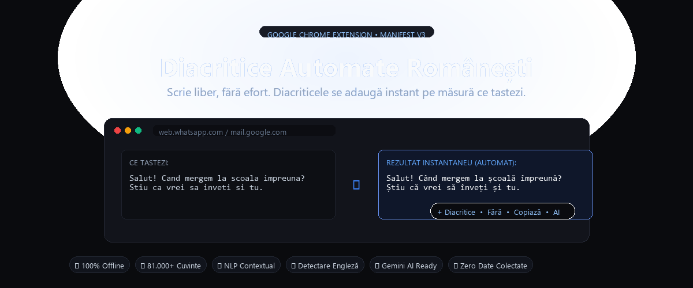
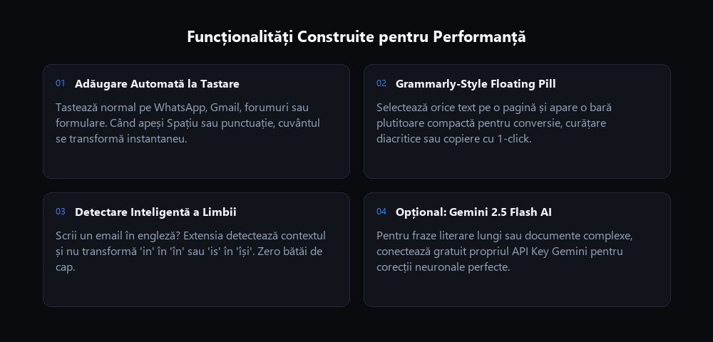

<div align="center">

  

  # 🇷🇴 Diacritice Automate Românești
  **Extensie Google Chrome (Manifest V3) • 100% Offline • Zero Telemetrie**

  <p align="center">
    Scrie liber și natural, fără efort. Diacriticele corecte se adaugă instantaneu pe măsură ce tastezi pe orice site web (WhatsApp Web, Gmail, Facebook, Messenger, Discord, Reddit, formulare, căutare etc.).
  </p>

  <p align="center">
    <a href="#-instalare-rapidă-sub-1-minut"></a>
    <a href="#-confidențialitate--securitate"></a>
    <a href="#-inteligență-contextuală-nlp"></a>
    <a href="#-gemini-ai-opțional"></a>
  </p>

  <p align="center">
    <a href="https://alexandru-radutoma.github.io/diacritice/"><strong>🌐 Deschide Website-ul Live Demo (GitHub Pages) »</strong></a>
  </p>

</div>

---

## ⚡ Cum funcționează

Tastezi normal, fără să te mai gândești la diacritice. Când apeși tasta **Spațiu** sau semne de punctuație (`,`, `.`, `!`, `?`), extensia transformă automat cuvântul tastat în forma sa corectă din limba română (conform normelor Academiei Române, cu virgulă dedesubt: `ă`, `â`, `î`, `ș`, `ț`).

```text
Tastezi:   Salut! Cand mergem la scoala impreuna daca poti? Stiu ca vrei sa inveti.
Rezultat:  Salut! Când mergem la școală împreună dacă poți? Știu că vrei să înveți.
```

---

## 🌟 Funcționalități Principale

<div align="center">
  
</div>

### 1. ⚡ Adăugare Automată la Tastare
Funcționează în timp real pe orice câmp de text, inclusiv în editoare complexe cu `contenteditable` (**WhatsApp Web, Gmail, Facebook Messenger, Discord, Reddit, Slack, Notion** etc.).

### 2. 🪄 Meniu Plutitor la Selecție (Stil Grammarly)
Oricând selectezi orice text cu mouse-ul pe o pagină web, deasupra selecției apare o capsulă plutitoare din sticlă mată cu acțiuni rapide:
* **`+ Diacritice`**: Adaugă diacritice pe loc.
* **`Fără`**: Elimină instant toate diacriticele (ideal pentru **SMS-uri** sau formulare oficiale/bancare care resping caracterele românești).
* **`Copiază`**: Transformă textul și îl trimite direct în clipboard.
* **`AI`**: Corecție avansată pe fraze literare lungi prin inteligență artificială.

### 3. 🧠 Detectare Inteligentă a Limbii (Engleză vs. Română)
Scrii un email în engleză? Extensia detectează automat contextul propoziției și **nu modifică** cuvinte comune din limba engleză (ex: `in` rămâne `in`, `is` rămâne `is`, `to` rămâne `to`).

### 4. 🔤 Dicționar Personalizat de Excepții (Whitelist)
Ai libertatea de a adăuga direct din interfață nume proprii, acronime sau termeni tehnici de specialitate (ex: `Alex`, `JavaScript`, `Docker`, `CEO`, `PR`) pe care extensia nu îi va atinge niciodată.

### 5. ✨ Integrare Opțională cu Google Gemini AI
Pentru documente oficiale, contracte sau fraze literare cu acorduri gramaticale complexe, poți conecta gratuit propriul tău API Key de la Google AI Studio (`Gemini 2.5 Flash`).

---

## ⌨️ Comenzi Rapide (Keyboard Shortcuts)

| Comandă | Acțiune |
| :--- | :--- |
| **`Spațiu` / `,` / `.` / `!` / `?`** | Adaugă diacritice automat la cuvântul tocmai tastat. |
| **`Alt + D`** | Adaugă diacritice la textul selectat sau pe tot câmpul activ. |
| **`Backspace`** | Dacă este apăsat imediat după o corecție, anulează automat modificarea (*Undo inteligent*). |

---

## 🚀 Instalare Rapidă (Sub 1 minut)

Extensia poate fi adăugată direct pe profilul tău de Google Chrome fără a fi nevoie de instalări complexe:

1. Descarcă sau clonează acest depozit:
   ```bash
   git clone https://github.com/alexandru-radutoma/diacritice.git
   ```
   *(Sau descarcă arhiva ZIP și dezarhivează dosarul).*
2. Deschide **Google Chrome** și accesează în bara de adrese:
   ```text
   chrome://extensions
   ```
3. În colțul din dreapta-sus, activează comutatorul **Mod dezvoltator** (*Developer mode*).
4. Dă click pe butonul **Încarcă extensia despachetată** (*Load unpacked*) din stânga-sus.
5. Selectează folderul proiectului (`diacritice`).
6. **Gata!** Extensia este instalată și activă imediat.

> [!TIP]
> **Fixează extensia în bară**: Apasă pe iconița cu piesă de puzzle din dreapta barei Chrome și apasă pe piuneză (pin) lângă **Diacritice** pentru acces rapid.

---

## 🔒 Confidențialitate & Securitate

* 🟢 **100% Procesare Locală**: Toată magia se întâmplă direct în browserul tău, folosind dicționarul offline de peste 81.000 de cuvinte.
* 🟢 **Fără Trackere sau Telemetrie**: Extensia nu stochează istoricul de navigare și nu trimite datele tastate nicăieri pe internet.
* 🟢 **Fără Server Backend Necesar**: Totul rulează instantaneu pe mașina ta.

---

## 🛠️ Structura Proiectului

```text
├── manifest.json       # Configurația Manifest V3
├── dict.js             # Baza de date lexicală (81.000+ cuvinte românești cu diacritice ISO)
├── rules.js            # Motorul NLP (morfologie, context propoziție, detecție limbă)
├── content.js          # Scriptul de injectare în pagini & logica de tastare
├── content.css         # Stiluri pentru meniul plutitor stil Grammarly și insignă
├── background.js       # Service worker pentru meniuri contextuale și Gemini API
├── popup.html / css/js # Interfața modernă Obsidian / Dark Graphite
├── assets/             # Grafică, bannere promoționale și iconițe
└── docs/               # Website-ul de prezentare live pentru GitHub Pages
```

---

## 📄 Licență

Acest proiect este licențiat sub licența **MIT** - liber de utilizat, modificat și distribuit.
